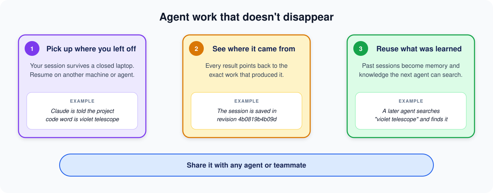

# Treating agent working context as infrastructure

_Who this is for: people building or running agent platforms and runtimes. Some sections assume basic Kubernetes familiarity._

AI agents rarely finish meaningful work in one uninterrupted session. They gather files, retrieve evidence, make decisions, produce intermediate results, and leave behind artifacts that another agent or person may need later.

That working material often has no clear home. Some of it lives in a project directory. Some remains in a conversation or an agent-specific state directory. Other pieces end up in object storage, a database, or a temporary execution environment. When the process stops, the laptop closes, or the work moves elsewhere, reconstructing the whole picture becomes difficult.

This article explores a straightforward idea: treat agent working context as infrastructure. Give it an identity, store it durably, track where it came from, and manage how agents capture, share, restore, and build on it. Context Service is an open source prototype for exploring that idea.

This is the first of three posts. This one covers the idea and the shape of the service. The [second post](../02-capture-version-and-reuse-agent-context/article.md) is a hands-on tour of the `contextctl` command line, and the [third](../03-delegating-local-agent-work-to-moca/article.md) shows a local agent delegating work to remote agents through [Moca](https://github.com/rossoctl/moca).

## Agent work is fragmented and temporary

Working context is the durable material an agent uses and creates while completing a task. It is more than a prompt, and more than a memory store.

A directory is a good place to work, but it does not answer several important questions:

- Which version did an agent use?
- What changed after that version?
- Where did a derived report or memory come from?
- Can another agent receive the same starting point?
- Can a user restore earlier work without destroying newer work?
- Who owns the context, and who may use it?
- Which sessions, agents, or environments currently consume it?

Agent frameworks answer some of these questions within their own harness runtime. The result is useful but fragmented. Moving work between frameworks, machines, people, or remote environments can require custom export code and a new storage design each time.

## Context has five layers

Context Service uses one umbrella term for the material that long-running agents depend on:

> **Context = Execution + Workspace + Memory + Knowledge + Artifacts**

This is not the context window that large language models use. It is the context that an agentic AI system uses.

- **Execution context** is the active state of an agent: harness state, prompts, tool history, and conversations. It lets an interrupted or restarted agent continue its work.
- **Workspace context** is where work happens: Git repositories, sandbox filesystems, source files, and other execution assets.
- **Memory** is durable experience carried beyond one execution or session. It may include observations, decisions, Markdown documents, reports, and other structured records.
- **Knowledge** is the understanding distilled from memory into reusable forms such as living wikis, documentation, and knowledge bases.
- **Artifacts** are the outputs of the work: reports, patches, datasets, logs, and build products. A workspace is mutable while an agent works. An artifact is a published, immutable result.

In the API, each layer is a context `type`: `state`, `workspace`, `memory`, `knowledge`, or `artifacts`. Execution context is the `state` type, the one the [next post](../02-capture-version-and-reuse-agent-context/article.md) uses.

These layers are related but distinct. A workspace is not automatically memory, and a collection of memories is not automatically knowledge. Each layer has different needs for mutability, retention, sharing, and trust, and today each is often managed by a different tool, if it is managed at all.

## Storage is necessary, but it is not context

Keeping the bytes is the foundation. A persistent volume or a bucket makes sure files survive. It does not say what those files mean, who they belong to, or which state is current. Context infrastructure adds five things on top of storage:

- **Ownership:** who owns this context?
- **Sharing:** who can discover it, read it, write to it, or build on it?
- **Versioning:** which state is current, and what came before it?
- **Provenance:** where did this result come from?
- **Lifecycle:** when does it change, and when does it end?

This is why the framing matters. A team that only has storage still has to build all five for every agent system, and each version looks different.

## Memory as infrastructure: the library analogy

Agent memory is often treated as a capability embedded separately in each agent system. The broader opportunity is to treat memory, and eventually all of context, as shared infrastructure.

A library is a useful analogy:

- memories are the books;
- Context Service is the library system that manages cataloging, access, provenance, versions, and lifecycle; and
- the knowledge layer continuously studies the collection and produces higher-level understanding.

Memory captures what happened. Knowledge captures what has been learned. Neither is the library itself. The infrastructure is what lets many agents and people use the same collection without each one building a private shelf.

## Three connected capabilities

Three capabilities follow from treating context this way.



The first captures and moves working data, so work survives a closed laptop and can resume on another machine or in another agent. The second preserves history and relationships through content-derived revisions, snapshots, clones, and lineage, so every result points back to the exact work that produced it. The third turns captured work into reusable memory and knowledge that the next agent can search. Sharing and access span all three.

The [next post](../02-capture-version-and-reuse-agent-context/article.md) walks through each of these with the `contextctl` command line.

## Context Service is a service

The command line is one way to use Context Service. It is also a server that runs in a Kubernetes cluster, so that platforms and agent runtimes can create and share context without each one managing storage itself.

A caller asks for a named context and describes the storage it needs: a type, a size, and an access mode. Context Service creates a PersistentVolumeClaim from whatever storage class the cluster offers and returns a stable attachment that a runtime can mount:

```json
{
  "name": "shared-review",
  "namespace": "team1",
  "type": "workspace",
  "storage": {
    "backend": "pvc",
    "size": "5Gi",
    "accessMode": "ReadWriteMany"
  }
}
```

The access mode decides the workspace topology. `ReadWriteOnce` gives one workload a dedicated workspace with independent filesystem state and strong isolation. `ReadWriteMany` lets several Pods mount the same context, so they share one set of files and artifacts. Read-only access is enforced at the consumer's mount, not as a separate volume. The workload picks the topology, and the infrastructure supports both.

Context is created at runtime, when a workload asks for it, not fixed when the platform is installed. The same service holds the context's revisions, snapshots, clones, grants, backup, and sync, whichever runtime mounts it.

## The runtime and the context stay separate

Agents need two kinds of infrastructure, and they change at different speeds. Execution environments, such as sandboxes, scheduling, and routing, are increasingly interchangeable. Durable context is not. It has to outlive any one runtime and move between clusters, machines, and people.

Context Service draws the line there:

| Layer | Responsibility |
|---|---|
| Context Service | Context identity, PVC lifecycle, revisions, snapshots, clones, access, backup, and sync |
| Kubernetes and the storage driver | Volume provisioning, attachment, and mount enforcement |
| The runtime, such as [Moca](https://github.com/rossoctl/moca) | Execution environments, routing, leases, and execution |
| The agent workload | Declares what it needs and does the work; does not create infrastructure |

[Moca](https://github.com/rossoctl/moca) is one such runtime. It is the workload-facing control plane that creates and selects the sandboxes where agents run. [Moca](https://github.com/rossoctl/moca) owns sandbox creation, routing, and release. Context Service owns the context those sandboxes mount. Deleting a sandbox never deletes its context, and Context Service never deletes a context that still has consumers unless forced.

This boundary came from the first implementation. The project began with one concrete problem: creating sandbox compute with durable workspace storage for [Moca](https://github.com/rossoctl/moca). An early version of Context Service created the sandboxes itself. Once runtimes began creating their own execution environments, that part moved out, and Context Service kept the storage and context. The result is a smaller service with a clearer job.

In the same spirit, [Moca](https://github.com/rossoctl/moca) builds its own workload API on top of Context Service. A workload bundles a frozen context revision with the sandboxes that run tasks against it, and a workload can get sandboxes and a mounted volume of its own. The third post covers that in detail. The pattern is the point: the runtime owns execution, Context Service owns context, and the two meet when a sandbox mounts durable context.

## Sharing needs ownership

Sharing is not a separate final stage. It applies across capture, history, and derivation.

One person might restore captured state into a later Claude Code session. Another might move the same project from Claude Code to Codex. Several agents might start from writable clones of one revision. A team might publish an immutable artifact while retaining the workspace and evidence that produced it.

In a shared cluster, the problem also becomes one of ownership. A context needs an identity independent of its storage path. Explicit grants control who can discover, read, write, attach, derive from, or administer it. Unauthorized lookups do not reveal that the context exists. Context Service authorizes the identity supplied by an authenticating gateway and does not validate credentials itself. In the prototype, that identity arrives in the `X-Context-Subject` header as `kind:name`, such as `user:alice`. A request without one is treated as `user:anonymous`.

## The difficult parts are boundaries, not storage

Persistent storage is necessary, but it is not the hardest part. The difficult questions appear where systems meet.

Who is allowed to create a context? Who can publish a revision? Does an agent receive storage credentials, or does a trusted control plane materialize context on its behalf? When several users share a cluster, what prevents one workload from mounting another user's data? What happens if transfer succeeds but the consumer fails? When can storage be deleted safely?

Implementation work has reinforced several design rules:

- Context identity remains separate from its physical storage name.
- Checksums are verified before a new revision becomes current.
- Source references are immutable provenance.
- Before a local restore overwrites the current files, it saves them as a snapshot you can go back to.
- Agent code does not receive infrastructure credentials or Kubernetes resources.
- Access is checked before context is discovered or attached.
- Context can outlive any one process or execution environment.

These rules make the system easier to reason about. They also allow agent runtimes, storage systems, and execution platforms to evolve independently.

## A shared foundation for long-running agent work

As agent work becomes longer, more collaborative, and more distributed, the durability of that work matters as much as the process performing it. Files, evidence, decisions, memory, knowledge, and artifacts should survive a stopped process. They should move without reconstructing an entire environment. They should retain enough history to support recovery and trust.

Agent platforms do not all need to build incompatible systems for storage, backup, lineage, sharing, and knowledge generation. They can share a context layer while continuing to innovate in planning, tools, execution, and user experience.

Context Service is still an early prototype, and its API is evolving. The open questions around identity, multi-user isolation, backend storage choice, collaboration, and knowledge quality are part of the exploration. But the central idea is already useful: give agent work a durable home, a history, and a path to become reusable knowledge.

## Learn more

- [Context Service on GitHub](https://github.com/rossoctl/context-service)
- [Context Service vision](https://github.com/rossoctl/context-service/blob/main/VISION.md)
- [Moca integration](https://github.com/rossoctl/context-service/blob/main/docs/moca.md)
- Next: [Capture, version, and reuse agent context with contextctl](../02-capture-version-and-reuse-agent-context/article.md)

_This post was written with assistance from an AI agent._
