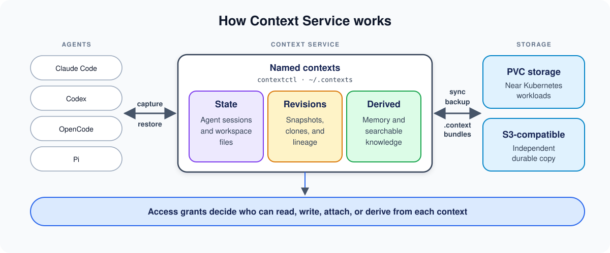

# Capture, version, and reuse agent context with contextctl

_Who this is for: developers who want to try `contextctl` on their own machine. The tutorial runs locally, and one optional step uses a Kubernetes cluster._

The [previous post](../01-treating-agent-working-context-as-infrastructure/article.md) argued that agent working context should be treated as infrastructure: a shared layer with identity, history, access control, and a lifecycle that outlives any one agent or process. This post is the hands-on companion. It uses `contextctl`, the Context Service command-line tool, to capture a Claude Code session into a named context, move and back it up, snapshot and clone it, and derive memory and knowledge from it.

Most of the steps run entirely on your machine, with context stored under `~/.contexts`. The step that uploads to a PVC needs a Kubernetes cluster running Context Service.

Context Service organizes this work around three connected capabilities.

The first capability captures and moves working data. The second preserves history and relationships. The third turns captured work into reusable memory and knowledge. Sharing and access span all three.



## Capture and transport working context

The first job is to give active work a durable home.

Context Service can capture native session state from Claude Code, Codex, OpenCode, or Pi. The captured files remain ordinary files in a named local context. The agent harness can continue to work normally while Context Service records updated revisions.

From there, the context can move without becoming tied to one transport:

- `sync` explicitly pushes or pulls a verified revision;
- `backup` continuously copies new local revisions in the background;
- portable `.context` bundles move as a file or through upload APIs;
- transfers to PVC-backed storage place context near Kubernetes workloads; and
- transfers to S3-compatible storage keep an independent durable copy.

Manual synchronization and continuous backup serve different purposes. Synchronization is an intentional point-in-time transfer. Backup observes later captures and asynchronously copies revisions to its configured destination. Both use checksums and content-addressed objects so an interrupted transfer never replaces the last valid revision.

Transport is not only about disaster recovery. Once working context has a portable form, a user can continue on another machine, restore into another compatible harness, or make the same revision available to a remote execution system.

## Preserve history and relationships

Moving files is useful. Knowing exactly what moved is more useful.

Context Service assigns a content-derived revision to each distinct set of portable content. Repeated capture of unchanged files keeps the same revision. Changed content appends a new revision to the context history.

Snapshots preserve important points in that history. Writable clones create independent branches for experiments or competing approaches. Before a local restore overwrites the current files, it saves them as a safety snapshot you can go back to, so recovery never silently destroys later work.

Lineage and provenance connect those revisions. When an agent derives memory, knowledge, or an artifact, the resulting context records the exact source context and revision. If the source changes later, the earlier result still explains what produced it.

This makes several questions answerable:

- Which captured session produced this memory?
- Is the remote copy current or stale?
- What revision did this report use?
- Which agent or process produced it?
- Which consumers are attached to this context now?

The `contextctl ctx graph` command combines these relationships into one view of sources, derivatives, active consumers, and storage copies. The graph turns a collection of directories into an inspectable history of work.

## Derive reusable memory and knowledge

Captured state is valuable for continuation, but replaying an entire session is not always the best way to reuse earlier work.

Context Service treats memory and knowledge as derived forms of context:

- A **memory context** extracts stable facts, decisions, preferences, workflows, and unresolved work from captured session state.
- A **knowledge context** compiles selected state and memory into a structured, interlinked collection of attributed records that is kept current as new material arrives.

The distinction matters. Memory preserves what should carry forward from an experience. Knowledge organizes material so another agent or person can retrieve only what is relevant.

Generation runs as an independent agent process and does not modify the captured source. The derived context records its generator and exact source revision. Its output remains inspectable Markdown, JSON, JSONL, and text rather than an opaque runtime store.

The initial knowledge search is deliberately simple and deterministic. Query results report their source context, revision, and file. A later vector or hybrid search implementation can improve retrieval without changing the contract presented to agents and applications.

This progression creates a useful feedback loop:

1. An agent performs work and leaves captured state.
2. Stable experience becomes durable memory.
3. Memory and selected source material become searchable knowledge.
4. Later agents retrieve attributed results and produce new work.

The source remains available when deeper inspection is necessary. Derived material does not erase its history.

## Share context across sessions, agents, and users

Sharing is not a separate final stage. It applies across capture, history, and derivation.

One person might restore captured state into a later Claude Code session. Another might move the same project from Claude Code to Codex. Several agents might start from writable clones of one revision. A team might publish an immutable artifact while retaining the workspace and evidence that produced it.

In a shared cluster, the problem also becomes one of ownership. A context needs an identity independent of its storage path. Explicit grants control who can discover, read, write, attach, derive from, or administer it. Unauthorized lookups do not reveal that the context exists.

The execution platform still owns processes, sandboxes, and scheduling. Context Service owns context identity, history, access, and storage lifecycle. Keeping that boundary clear lets different agent and execution systems use the same context infrastructure without turning Context Service into another runtime.

## Tutorial: Try It Locally

You can explore all three capabilities without Kubernetes or a running Context Service API. The local CLI stores everything under `~/.contexts` by default. The sample output below is trimmed, and your revision IDs, paths, and timestamps will differ.

Install `contextctl`:

```console
$ curl -fsSL https://raw.githubusercontent.com/rossoctl/context-service/main/install.sh | sh
```

### 1. Capture an agent session

From a project directory, create a local state context and attach Claude Code:

```console
$ contextctl ctx create demo --type state --backend filesystem

$ contextctl ctx attach demo --harness claude
```

Next, launch Claude Code from the same project directory and ask it to remember a project decision:

```console
$ claude
```

```text
❯ Remember that the project code word is violet telescope.
```

Wait for its response, then either keep chatting or exit with `/exit`. Context Service captures the native session state automatically. Capture is not a one-time event: each completed turn records a new revision of the session under `~/.contexts`. Each harness has its own integration point: hooks for Claude Code and Codex, a plugin for OpenCode, and an extension for Pi.

Inspect the result:

```console
$ contextctl ctx get demo --backend filesystem
demo  ready · state · filesystem
└── path  /Users/daniel/.contexts/demo
    └── revision  4b0819b4b09d
    └── Claude  1 sessions · 145.8 KiB
    └── attached to Claude  /Users/daniel/projects/agent-notes
```

The first line shows the context's name, status, type, and storage backend. The lines below show its path, current revision, the number and size of captured Claude Code sessions, and the project it is attached to.

```console
$ contextctl ctx revisions demo
REVISIONS (2)
4b0819b4b09d  capture · claude · 2026-11-17T17:39:48Z · current
891b59183f30  capture · claude · 2026-11-17T17:39:48Z
```

In this run, the single prompt produced two revisions: one when the response completed and one when the session ended. If you keep chatting instead of exiting, `ctx revisions` shows only the first. Each revision ID is derived from a hash of the captured content, so unchanged state does not add a duplicate entry.

Now that the session is captured, you can do more with it than inspect it. A captured context is a verified, portable unit, so you can copy it, upload it to a PVC, or keep it backed up as it changes.

Copy a context by exporting it as a portable bundle and importing it under a new name:

```console
$ contextctl ctx export demo
Exported demo to /Users/daniel/projects/agent-notes/demo.context
Files: 3 (147.3 KiB)

$ contextctl ctx import demo.context --name demo-copy
Imported demo-copy from /Users/daniel/projects/agent-notes/demo.context
demo-copy  ready · state · filesystem
└── path  /Users/daniel/.contexts/demo-copy
    └── revision  4b0819b4b09d
    └── Claude  1 sessions · 145.8 KiB
```

The bundle is a checksummed file that carries the session, its revision history, and its provenance. Import verifies it and never overwrites an existing context, so the same file can move your work to another machine or fork it locally.

Upload a context to a PVC with `sync`. Create a PVC-backed context, then push the local one into it:

```console
$ contextctl ctx create cloud-demo --type state

$ contextctl ctx list
CONTEXTS

FILESYSTEM (1)
demo  Ready · state
└── path  /Users/daniel/.contexts/demo
    └── Claude  1 sessions · 145.8 KiB
    └── attached to Claude  /Users/daniel/projects/agent-notes

PVC (1)
cloud-demo  Ready · state
└── pvc/context-cloud-demo  1Gi RWO · standard · namespace context-service

$ contextctl ctx sync push demo --remote-name cloud-demo
Uploading   100%  31.4 KiB / 31.4 KiB  31.4 KiB/s  00:01
Synced demo to pvc/context-cloud-demo in namespace context-service
Files: 3 (147.3 KiB)
```

Depending on the cluster's storage class, `cloud-demo` can show `Provisioning` in the `ctx list` output until its volume is bound.

`sync push` streams the bundle through Kubernetes and verifies its checksum before publishing the revision. The captured session ends up on storage next to your Kubernetes workloads, without a manual copy.

Next, say you want to back up the context, for example to S3, so a lost laptop or a deleted directory doesn't take your agent's work with it. Backup is continuous. Configure one remote destination and a worker keeps it current in the background, with nothing to rerun after each session:

```console
$ contextctl ctx backup start demo --to s3://daniel-agent-contexts/demo
Backup started for demo → s3://daniel-agent-contexts/demo
Every 5m0s · pid 48213

$ contextctl ctx backup status demo
demo  Running · every 5m0s
└── s3://daniel-agent-contexts/demo
    last attempt  2026-11-17T10:39:50-07:00
    last success  2026-11-17T10:39:51-07:00 · 2 files · 145.8 KiB
    revision      4b0819b4b09d2a97516c354b68848cdbd8f54a226a0a55b21ed138e207ad6c5c
    log           /Users/daniel/.contexts/demo/.backup/backup.log
```

`backup start` launches a detached `contextctl ctx backup run` process that keeps running after your terminal closes. Each Claude Code capture hook signals the worker, which waits two seconds for activity to settle and then uploads the new revision. The worker also runs on a periodic interval and skips the upload when the revision has not changed. A failed transfer leaves the last verified copy in place and retries with backoff, so the destination always holds a valid revision.

An S3-compatible destination uses your normal S3 credentials. A PVC target, such as `pvc://context-service/cloud-demo`, works the same way.

### 2. Preserve and inspect its history

Because the session is captured as a context, you can snapshot it and clone it. Create a snapshot and a writable branch:

```console
$ contextctl ctx snapshot create demo baseline
baseline  ready · 4b0819b4b09d · 145.8 KiB

$ contextctl ctx snapshot clone demo@baseline experiment
experiment  ready · state · filesystem
└── path  /Users/daniel/.contexts/experiment
    └── revision  4b0819b4b09d
    └── source  demo@4b0819b4b09d · snapshot-clone
    └── Claude  1 sessions · 145.8 KiB
```

The snapshot freezes an exact revision of the session. The clone is a new writable context that records the revision it came from, so you can take the work in a different direction without touching `demo`.

```console
$ contextctl ctx graph
CONTEXT GRAPH (2)
demo  state · filesystem · Ready · 4b0819b4b09d
├── location  /Users/daniel/.contexts/demo
├── derives  experiment@4b0819b4b09d · state · filesystem · ready
├── consumer  harness/Claude · /Users/daniel/projects/agent-notes · attached
├── copy  pvc/context-cloud-demo · namespace context-service · 4b0819b4b09d · ready
└── copy  s3://daniel-agent-contexts/demo · ready

experiment  state · filesystem · Ready · 4b0819b4b09d
├── location  /Users/daniel/.contexts/experiment
└── source  demo@4b0819b4b09d · state · filesystem · ready
```

The graph shows each context with its sources, derivatives, attached harness, and remote copies. Clones appear under the exact revision they came from, so the history of your work reads as a version tree you can inspect. The graph also lists `demo-copy` from the export and import step. This sample leaves it out to keep it short.

### 3. Generate memory and knowledge

Derive durable memory from the captured session:

```console
$ contextctl ctx derive memory demo --name demo-memory --agent claude
Generated demo-memory from demo@4b0819b4b09d
Memory: /Users/daniel/.contexts/demo-memory/memory/MEMORY.md
Generator: claude

$ contextctl ctx lineage demo-memory
LINEAGE · demo-memory
d27a91c05e3b  derive · claude
└── demo@4b0819b4b09d  state · available
```

The memory is generated from the captured session, not written by hand, and its lineage names the exact revision of `demo` it was derived from. Capturing the session first is what makes this possible.

Build searchable knowledge from both the original state and the derived memory:

```console
$ contextctl ctx derive knowledge \
  --name demo-knowledge \
  --from demo \
  --from demo-memory \
  --agent claude
Generated demo-knowledge from 2 contexts
Records: 4 (0 reused)
Knowledge: /Users/daniel/.contexts/demo-knowledge/knowledge

$ contextctl ctx search demo-knowledge "violet telescope"
RESULTS (2)
1. Project code word
   The project code word is "violet telescope".
   source  demo-memory@d27a91c05e3b · memory/MEMORY.md

2. Project code word
   The user asked Claude to remember that the project code word is violet telescope.
   source  demo@4b0819b4b09d · harnesses/claude/project/3f6c9e1a-52d7-4b08-9a41-c7e0d2b85f13.jsonl
```

This is the powerful step. Several pieces of context, here a raw session and the memory derived from it, combine into a single knowledge tree. Every result reports the context, revision, and file it came from.

```console
$ contextctl ctx graph
CONTEXT GRAPH (4)
demo  state · filesystem · Ready · 4b0819b4b09d
├── location  /Users/daniel/.contexts/demo
├── derives  demo-knowledge@7f3c28b6e1a4 · knowledge · filesystem · ready
├── derives  demo-memory@d27a91c05e3b · memory · filesystem · ready
├── derives  experiment@4b0819b4b09d · state · filesystem · ready
├── consumer  harness/Claude · /Users/daniel/projects/agent-notes · attached
├── copy  pvc/context-cloud-demo · namespace context-service · 4b0819b4b09d · ready
└── copy  s3://daniel-agent-contexts/demo · ready

demo-knowledge  knowledge · filesystem · Ready · 7f3c28b6e1a4
├── location  /Users/daniel/.contexts/demo-knowledge
├── source  demo@4b0819b4b09d · state · filesystem · ready
└── source  demo-memory@d27a91c05e3b · memory · filesystem · ready

demo-memory  memory · filesystem · Ready · d27a91c05e3b
├── location  /Users/daniel/.contexts/demo-memory
├── source  demo@4b0819b4b09d · state · filesystem · ready
└── derives  demo-knowledge@7f3c28b6e1a4 · knowledge · filesystem · ready

experiment  state · filesystem · Ready · 4b0819b4b09d
├── location  /Users/daniel/.contexts/experiment
└── source  demo@4b0819b4b09d · state · filesystem · ready
```

The final graph shows the captured state, its durable memory, the knowledge derived from both, and the exact revisions connecting them. As in the first graph, `demo-copy` is left out of the sample.

## What comes next

Everything here ran on a single machine, with `contextctl` talking to local storage or a remote destination. Context Service also runs as a central service on Kubernetes, where other systems create contexts and mount them. The [next post](../03-delegating-local-agent-work-to-moca/article.md) uses that to delegate work from a local agent to remote agents: the agent packs a directory with `contextctl`, uploads it once as a frozen revision, and asks [Moca](https://github.com/rossoctl/moca) to run many tasks against it. The [first post](../01-treating-agent-working-context-as-infrastructure/article.md) covers why Context Service and the runtime stay separate.

## Learn more

- [Context Service on GitHub](https://github.com/rossoctl/context-service)
- [Context Service vision](https://github.com/rossoctl/context-service/blob/main/VISION.md)
- [Capture local agent state](https://github.com/rossoctl/context-service/tree/main/demos/local/harness-capture)
- [Explore context lineage](https://github.com/rossoctl/context-service/tree/main/demos/local/context-lineage)
- [Try Context Service on Kind](https://github.com/rossoctl/context-service/tree/main/demos/kind)
- Previous: [Treating agent working context as infrastructure](../01-treating-agent-working-context-as-infrastructure/article.md)
- Next: [Delegating local agent work to Moca](../03-delegating-local-agent-work-to-moca/article.md)

_This post was written with assistance from an AI agent._
