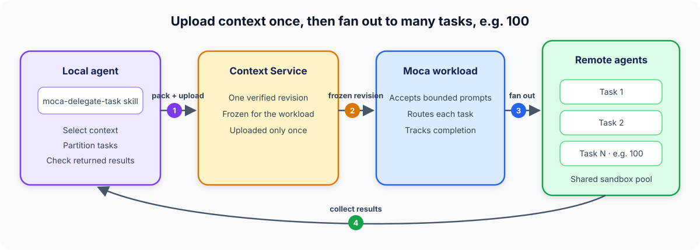
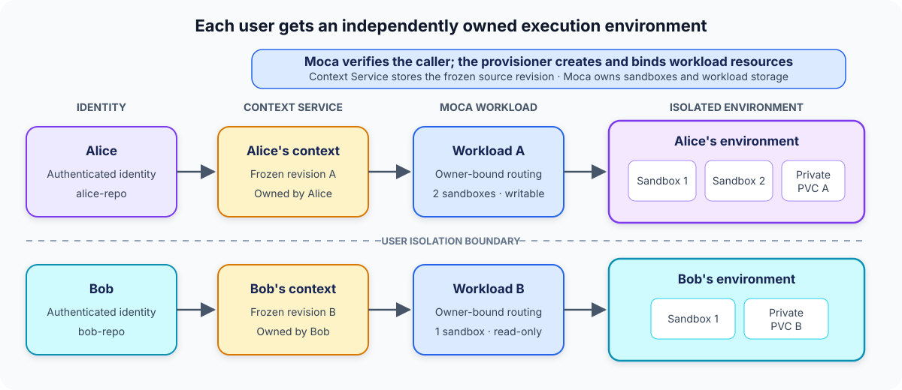

# Delegating local agent work to Moca

The [previous post](../02-capture-version-and-reuse-agent-context/article.md) used `contextctl` to capture an agent session as a named context, move it, and derive memory and knowledge from it. This post puts the same machinery to work on a different problem: handing part of a local agent's job to remote agents. The [first post](../01-treating-agent-working-context-as-infrastructure/article.md) explains why working context deserves its own infrastructure layer, and why that layer stays separate from the runtime that executes agents. Delegation shows that boundary in practice.

A local coding agent has an unusual advantage: it already understands the work in progress. It can inspect the repository, follow the conversation, identify the relevant files, and turn a broad request into smaller tasks.

It also has familiar constraints. The laptop may need to close. A large analysis may take hours. Many independent tasks could run in parallel, but local compute limits how much work can happen at once. The remote servers where [Moca](https://github.com/rossoctl/moca) runs may also have specialized hardware that is more powerful than a typical laptop. Remote execution can help, but only if the remote agents receive the right working context and the user can trust where each task runs.

The [`moca-delegate-task` skill](https://github.com/rossoctl/moca/tree/main/skills/moca-delegate-task) was built to explore that boundary. It teaches a local agent to select and package relevant files, upload them once as a Context Service revision, ask [Moca](https://github.com/rossoctl/moca) to execute one or many bounded tasks, collect the results, and clean up the temporary workload. [Moca](https://github.com/rossoctl/moca) is the workload-facing control plane that creates and selects the sandboxes where agents run. Context Service stores the context those sandboxes use.

The work developed in two phases:

1. **Single-user delegation and fan-out:** one user delegates anywhere from one task to many independent subagent tasks, such as a hundred at once.
2. **Multi-user isolation:** several users delegate concurrently, with separate identities, workloads, sandboxes, and storage.

Together, the two phases show how a local agent workflow can grow into a multi-user cloud service without giving agent code direct control of Kubernetes. The skill is a preview: its interfaces and limits may still change.

## Make delegation part of the agent workflow

Delegation is more than sending a prompt to a remote API. A useful workflow must decide:

- which local files the task needs;
- which files must not leave the machine;
- whether tasks are independent or build on shared state;
- how remote agents receive one consistent revision;
- where each task is allowed to run;
- how results return to the local user; and
- what gets deleted afterward.

The skill encodes those decisions as instructions for Claude Code, Codex, OpenCode, or another compatible agent harness. It uses two command-line tools:

- `contextctl` selects and packs a directory into a verified `.context` bundle;
- `mocactl` creates the [Moca](https://github.com/rossoctl/moca) workload, starts subagent tasks, monitors them, retrieves their results, and deletes the workload.

The local agent still owns task decomposition. [Moca](https://github.com/rossoctl/moca) owns remote execution. Context Service owns the uploaded context and its frozen revision.

## Phase 1: upload once and fan out

The first phase focuses on one user and one body of working context.



The flow is deliberately small:

1. The local agent chooses the smallest directory that contains the required files.
2. It checks for secrets and tells the user what will be uploaded.
3. `contextctl` packs the directory into one portable context bundle.
4. `mocactl` creates a workload and uploads the bundle directly to Context Service.
5. [Moca](https://github.com/rossoctl/moca) freezes that exact revision for the workload.
6. The local agent spawns one bounded task per prompt.
7. [Moca](https://github.com/rossoctl/moca) distributes the tasks across its available sandboxes.
8. The local agent collects and checks each result.
9. The workload and local bundle are deleted. If the agent skips this step, the workload keeps running, and `mocactl workloads list` shows the ones you still have.

The important scaling property is that the context moves once. One task can use it, or many independent tasks, a hundred for example, can share the same verified starting point. A codebase might be reviewed one package at a time. A collection of incident reports might be analyzed one report at a time. A migration assessment might assign one service to each subagent.

Each prompt must remain self-contained. The remote agent sees the prompt and the uploaded context, not the original conversation. The local agent therefore states the expected output and how it will be checked.

### Read-only analysis and writable work

Most fan-out tasks should consume context read-only. Independent readers cannot overwrite one another's inputs, and their results return as text or structured output.

When a task needs to edit, build, or test, [Moca](https://github.com/rossoctl/moca) can provide a writable copy for that run. The copy disappears when the run ends, so the task returns a patch or other result rather than silently changing the user's local tree.

This model is useful for bounded independent work. It does not create a persistent shared development environment, and shared-pool sandboxes are not a security boundary between users. Those constraints led to Phase 2.

## Phase 2: give each user an isolated workload

Multi-user delegation changes the problem. Alice and Bob can both authenticate to [Moca](https://github.com/rossoctl/moca), but identity at the API is not enough. If their tasks run in the same sandbox as the same operating-system user, they do not have a meaningful execution boundary.

Phase 2 gives a workload its own sandbox pods and, when requested, its own mounted volume. Alice's tasks run only in Alice's workload sandboxes. Bob's run only in Bob's. A normal task without a workload continues to use the shared pool.



The user requests the environment while creating the workload:

```sh
mocactl workloads create \
  --context .moca-delegate/repo.context \
  --sandboxes 2 \
  --mount read-only
```

[Moca](https://github.com/rossoctl/moca) then:

1. authenticates the caller and creates the workload record;
2. freezes the Context Service revision uploaded for that workload;
3. asks its trusted provisioner to create the workload's sandbox pods and volume;
4. seeds the volume from the frozen context revision;
5. issues a signed attach token that binds the sandboxes to the workload and owner;
6. routes workload tasks only to sandboxes with that verified binding; and
7. deletes the sandboxes and volume before deleting the Context.

Context Service does not create the sandboxes. It supplies the frozen source revision, exactly as it does in Phase 1. [Moca](https://github.com/rossoctl/moca)'s `moca-provisioner` owns the workload's execution resources and mounted volume. It is the only [Moca](https://github.com/rossoctl/moca) component allowed to create workload resources in the sandbox namespace.

That separation keeps model-influenced workers away from Kubernetes credentials. The provisioner has namespace-scoped permissions and cannot read Secrets, and an admission policy limits the pods it creates. The control plane, supervisor, relay, and sandboxes cannot create Pods or PersistentVolumeClaims.

### Read-only and writable mounted workspaces

A read-only mount gives every sandbox in the workload the same immutable starting point. It fits parallel analysis.

A writable mount creates a shared working tree that persists across tasks for the lifetime of the workload. This supports a sequence in which one task makes a change and a later task tests or reviews it. Concurrent writers are unsafe because [Moca](https://github.com/rossoctl/moca) does not add file-level locking, so the skill runs dependent writing tasks in sequence.

The volume's access mode follows the storage class. By default the claim is `ReadWriteOnce`, and [Moca](https://github.com/rossoctl/moca) schedules all of the workload's sandboxes onto one node so they can mount it. A storage class that the operator marks as supporting `ReadWriteMany` lets the sandboxes spread across nodes. The workload chooses the topology it needs, and the operator decides which storage classes are allowed.

The mounted workspace is still temporary infrastructure. It never changes the user's local tree automatically. The agent must return the relevant patch, report, or other output for local review.

## What the two-user demo checks

The [two-user demo](https://github.com/rossoctl/moca/tree/main/skills/moca-delegate-task/demo-two-users) runs on Kind with two independent identities and two small repositories:

- Alice requests two sandboxes with a writable mount.
- Bob requests one sandbox with a read-only mount.
- Each user runs tasks only on their own workload.
- Bob receives `404` when he tries to read, run against, or delete Alice's workload.
- Neither task can find the other user's marker files.
- Alice writes a file in one task and reads it from both of her sandboxes later.
- Bob's attempted write fails.
- Forged sandbox registrations cannot claim another workload's identity.
- Deleting both workloads removes their pods, services, credentials, volumes, and Contexts.
- A workload created without dedicated sandboxes continues to use the Phase 1 shared-pool behavior.

This is more than a happy-path demo. It tests the identity and routing boundaries that distinguish multi-user infrastructure from parallel execution on a shared machine.

## Try both phases on Kind

Both demos run on local Kind clusters and use a scripted model, so they do not require a model API key. They bind persistent local ports instead of requiring port-forwarding and restore the user's previous Kubernetes context when setup exits.

Clone [Moca](https://github.com/rossoctl/moca) and install its dependencies first. Then run the Phase 1 demo:

```sh
skills/moca-delegate-task/demo/setup.sh --build
skills/moca-delegate-task/demo/run.sh
skills/moca-delegate-task/demo/setup.sh --delete
```

The checked-in demo keeps the flow small: it uploads one example repository and runs one read-only task and one writable task. The same workload and `mocactl spawn` interface support a larger fan-out.

Run the two-user demo separately:

```sh
skills/moca-delegate-task/demo-two-users/setup.sh --build
skills/moca-delegate-task/demo-two-users/run.sh
skills/moca-delegate-task/demo-two-users/setup.sh --delete
```

The two-user script runs the checks described above and prints a PASS or FAIL result for each isolation and lifecycle check. It uses separate local login state and different host ports, so it does not overwrite a developer's normal `mocactl` login.

## Next steps

Phase 1 showed that a local agent can upload relevant work once and distribute many bounded tasks to remote agents. Phase 2 showed that several users can do that concurrently without sharing execution or storage boundaries.

Isolation is only half of the problem. Alice and Bob now have separate environments, but real work often crosses those boundaries. What happens when Bob wants to hand Alice a specific context revision so she can continue his work? When should several workloads receive clones of one revision instead of one shared writable tree? How should one agent's results become durable context that another agent builds on, rather than a transient response?

Those questions point to the next workloads worth exploring:

- **Sharing between people:** Bob grants Alice access to a context revision, and her workload starts from exactly the state his agents left.
- **Agent-to-agent collaboration:** one agent's output becomes a new revision that another agent consumes, with provenance linking the two.
- **Shared corpus, private workspace:** many workloads read one shared, read-only corpus while each keeps its own writable workspace.
- **Promotion into memory and knowledge:** useful results move out of a temporary workload into durable memory or a knowledge base that later agents can search.

Each of these needs the same answers: who owns the context, who may use it, and how the system shows provenance when people and agents continue one another's work. The [context workflows](https://github.com/rossoctl/moca/blob/main/docs/concepts/context-workflows.md#workflows) in the Moca docs list more of these workloads.

Those questions connect delegation back to the [first post](../01-treating-agent-working-context-as-infrastructure/article.md)'s case for treating working context as infrastructure. Remote execution is one consumer of context. Durable, versioned, shareable working context is the foundation that lets it become more than a remote prompt API.

## Learn more

- [Moca on GitHub](https://github.com/rossoctl/moca)
- [Context Service on GitHub](https://github.com/rossoctl/context-service)
- [The `moca-delegate-task` skill](https://github.com/rossoctl/moca/tree/main/skills/moca-delegate-task)
- [Phase 1 Kind demo](https://github.com/rossoctl/moca/tree/main/skills/moca-delegate-task/demo)
- [Phase 2 two-user demo](https://github.com/rossoctl/moca/tree/main/skills/moca-delegate-task/demo-two-users)
- [A delegation demo with a real model in Claude Code or OpenCode](https://github.com/rossoctl/state-lab/tree/main/docs/demos/subagents/moca-delegated)
- [How Moca uses Context Service](https://github.com/rossoctl/moca/blob/main/docs/context-service.md)
- Previous: [Capture, version, and reuse agent context with contextctl](../02-capture-version-and-reuse-agent-context/article.md)

_This post was written with assistance from an AI agent._
